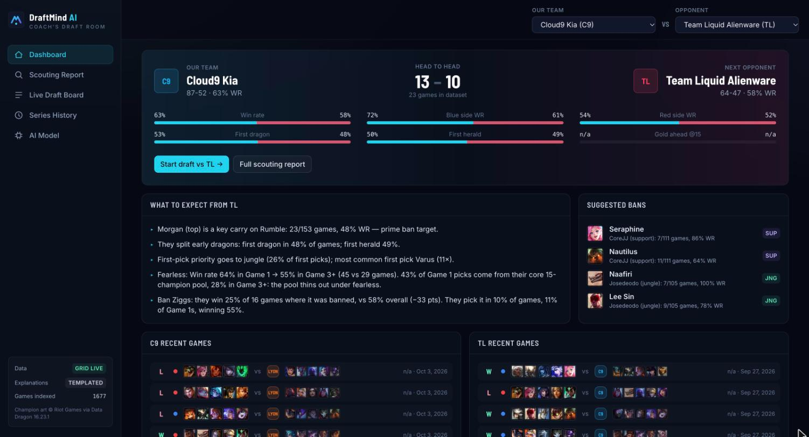
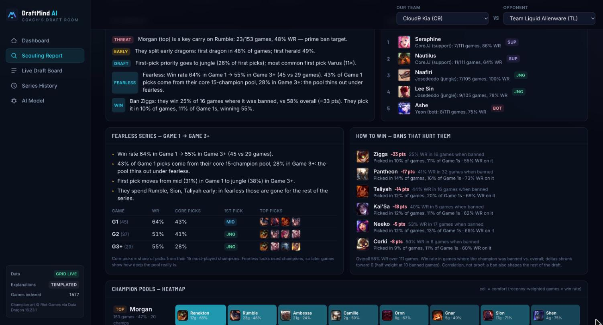
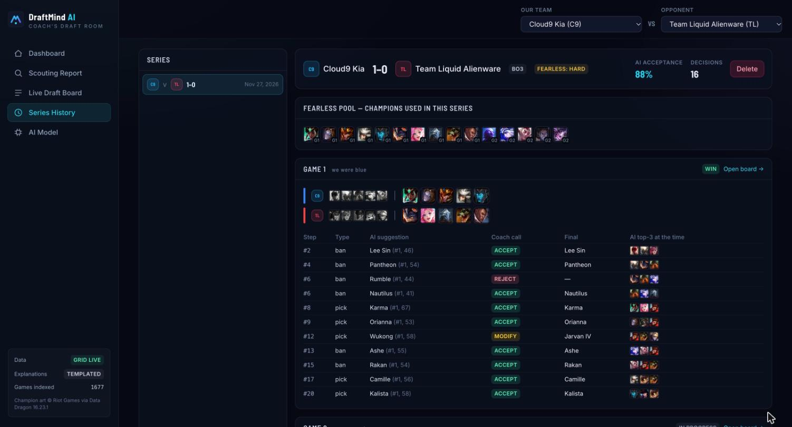
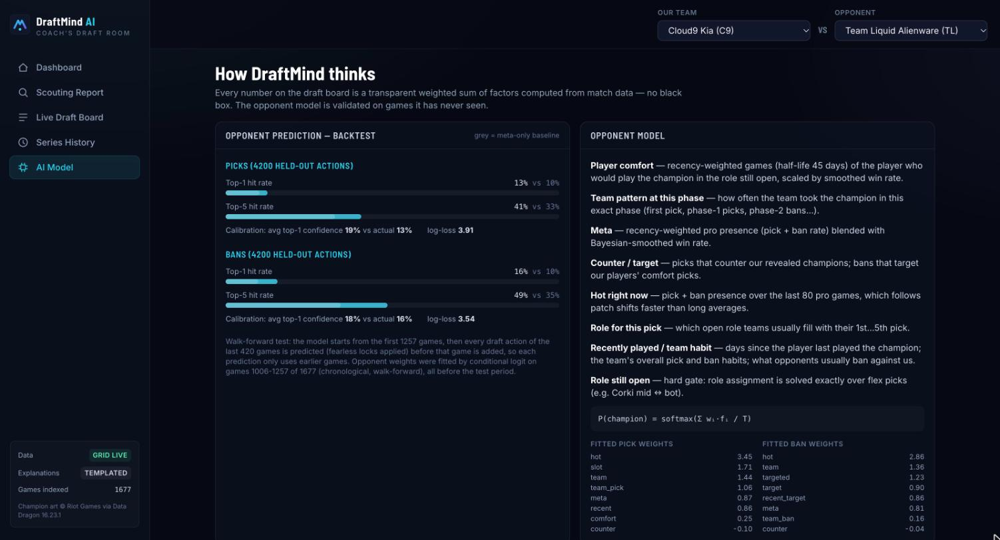
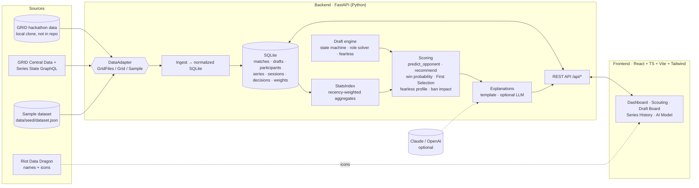

# DraftMind AI

**An explainable AI draft room for League of Legends coaches.** DraftMind scouts the opponent, predicts their next pick or ban with calibrated probabilities, and recommends your next move. Every score breaks down into the stats behind it. The coach stays in control: each suggestion can be accepted, modified or rejected, and DraftMind learns from those calls.

Built for the **Cloud9 × JetBrains "Sky's The Limit" Hackathon, Category 2: LoL Macro Scouting & Draft Management.** It runs on the **official GRID hackathon data**: 1,677 pro games from LCK, LEC, LCS and LTA, 2025–2026. **Cloud9 Kia** is the default team.

**Live demo:** https://draftmind-api.onrender.com. The demo is password-protected because the GRID data is licensed for judges and organizers only; the credentials are in the Devpost testing instructions. The first load can take up to a minute while the free instance wakes up.


| Dashboard | Scouting Report |
|---|---|
|  |  |
| **Series History** | **AI Model** |
|  |  |

---

## Why

Coaches still scout in spreadsheets: they count champion pools by hand, guess what the opponent will first-pick, and keep fearless-draft lockouts in their heads during a Bo5. DraftMind replaces that workflow with one tool:

| Capability | Where |
|---|---|
| **Opponent analysis**: per-player champion pools (heatmap), pick/ban tables, first-pick priorities, blue/red win rates, first blood/dragon/herald/tower, gold@15, auto-generated insights and a ban plan | Scouting Report, Dashboard |
| **Draft prediction**: the opponent's likely next pick or ban, top 5 with probabilities | Live Draft Board |
| **Recommendations**: our best next pick or ban, scored on meta strength, counter value, synergy, player comfort, denial and coach history | Live Draft Board |
| **Human in the loop**: Accept / Modify / Reject on every suggestion; each call is logged and shifts later suggestions | Live Draft Board, Series History |
| **Explainable AI**: a "Why?" breakdown on every suggestion (factor × weight = contribution, with the evidence), plus an optional plain-English explanation | Live Draft Board |
| **Fearless draft**: hard or soft fearless series tracking; used champions are locked out automatically in later games | Draft setup, Live Draft Board |
| **Tunable model**: coaches set the factor weights in a settings drawer | Live Draft Board → ⚖ Weights |
| **Export**: scouting report as Markdown, or as PDF through a print layout | Scouting Report |
| **First Selection advisor** (2026 rule): take a side or the first draft turn? Expected win rate for each choice after the opponent's best reply, from First Selection era games and both teams' tendencies | Draft setup |
| **Fearless Game 1 → Game 3+**: how the opponent's win rate, first-pick role, favourite picks and pool depth change as a fearless series goes on | Scouting Report, Dashboard |
| **How to win**: the bans that hurt the opponent most (their win rate when a champion was banned vs overall) | Scouting Report, Dashboard |
| **Live win probability**: our chance to win as the draft unfolds, with the factors behind it and each suggested pick's effect | Live Draft Board |

## Quick start

The app runs fully offline and needs no API keys. It uses the GRID hackathon data when a clone of it sits next to this repo (see [Deployment](#deployment)). Otherwise it falls back to the bundled synthetic dataset.

### Option A: Docker (one command)

```bash
docker compose up --build
# → http://localhost:8080   (API + Swagger docs at http://localhost:8000/docs)
```

### Option B: no Docker (one command)

Requires Python ≥ 3.9 and Node ≥ 20.

```bash
./scripts/dev.sh          # or: make dev
# → http://127.0.0.1:5173  (API at http://127.0.0.1:8000/docs)
```

On the first run the script creates `backend/.venv` and runs `npm ci`. It then starts the FastAPI backend and the Vite dev server together.

<details><summary>Manual steps</summary>

```bash
# backend
cd backend && python3 -m venv .venv && .venv/bin/pip install -r requirements-dev.txt
.venv/bin/uvicorn app.main:app --reload --port 8000
# frontend (new terminal)
cd frontend && npm ci && npm run dev
```
</details>

### Optional configuration

Copy `.env.example` to `.env`:

| Variable | Effect |
|---|---|
| `GRID_API_KEY` | Switches the data source to live GRID esports data. If GRID fails, the app falls back to the sample data and says so on `/api/health`. |
| `ANTHROPIC_API_KEY` (or `OPENAI_API_KEY`) | The "Explain in plain English" button then uses an LLM (Claude `claude-opus-5-5` by default) to rephrase the factor breakdown. Without a key it uses templated explanations. |
| `DATA_SOURCE` | `auto` (default), `sample` or `grid` |
| `CORS_ORIGINS`, `DB_PATH`, `RECENCY_HALF_LIFE_DAYS`, `VITE_API_URL` | See `.env.example` |

## 3-minute demo script

With the GRID data loaded (the live demo, or a local run with the data next to the repo):

1. **Dashboard**: *Cloud9 Kia* vs *Team Liquid* opens by default: head-to-head 13–10, side and early-game comparisons, what to expect from Team Liquid, and a ban plan built from their players' pools.
2. **Scouting Report → Team Liquid**:
   - The *Fearless series* panel answers "how does their draft shift in Game 3+?": 64% win rate in Game 1 vs 55% in Game 3+, core-pool picks fall from 43% to 28%, and first pick moves from mid to jungle.
   - The *How to win* panel lists the bans that hurt them most, for example *Ziggs: they win 25% of 16 games where it was banned, vs 58% overall*.
   - Export the report as Markdown or PDF.
3. **Live Draft Board → setup**: the *First Selection* panel advises "Take blue side: about 62% expected win rate even after the opponent's best reply". Click **Use**, choose Bo3 hard fearless, and start the draft.
4. **Draft**:
   - Follow the win-probability bar.
   - Read the top suggestion, then open **Why?** to see each factor's contribution and evidence.
   - Enter the opponent's actions, or lock in a predicted one.
   - **Reject** one suggestion and **Modify** another. Both are logged.
5. Finish the draft, then click **We won** and **Start game 2**. Every champion picked in game 1 is now locked 🔒 for both teams.
6. **Series History** shows each coach decision next to the AI's top 3 at that moment. **AI Model** shows the held-out backtest and the fitted weights.

Without the GRID data, the app runs on the bundled synthetic dataset (Nimbus Esports vs Iron Wolves) with the same features.

## Architecture



```
/backend   FastAPI app (app/), engine (app/engine/), adapters (app/adapters/), tests/,
           scripts/ (fit the opponent and win-probability models on the GRID data)
/http      JetBrains HTTP Client checks for the API
/frontend  React + TypeScript + Vite + Tailwind v4 SPA
/data      champions.json (Data Dragon snapshot + role map), seed/dataset.json, scripts/ (generators)
/docs      screenshots
/.run      shared JetBrains run configurations
/.idea     PyCharm project files
```

## Methodology

All analytics are computed from the normalized match tables. The engine does not know whether the data came from GRID or from the sample set.

### Statistics
- **Recency weighting**: each game counts `0.5^(age / 45 days)`, measured from the newest game in the dataset. Comfort and meta therefore track current form.
- **Bayesian smoothing**: win rates shrink toward 50% (`(wins + 0.5k)/(games + k)`), so a 1/1 record is never scored as a 100% win rate (the tables still show raw records).
- **Role solver**: Riot data has no positions. DraftMind combines a curated pro role map with an exact assignment solver over flex picks: Corki moves mid ↔ bot, and Gragas can go top, jungle or support. "Is the role still open?" is a hard feasibility check.
- **Matchups and synergy** blend pro lane results with solo-queue-style priors (pseudo-count 20). Synergy is measured as the pair's lift over the two champions' individual win rates.

### Opponent prediction
For every champion the opponent could legally take at this step, the model computes a set of factors:

- **Picks:** the player's comfort in the open role; how recently they played the champion; the team's pattern in this phase and its overall pick habit; meta; "hot right now", which is presence over the last 80 pro games; the role teams usually fill with their n-th pick; and counter value against our picks.
- **Bans:** whether it targets our players' comfort or recent picks; the team's ban pattern in this phase and overall; what opponents usually ban against us; meta; hot right now; and counter value against their picks.

Probabilities are `softmax(Σ wᵢ·fᵢ / T)`. The weights are fitted on the GRID data by conditional logit (`backend/scripts/fit_opponent_model.py`). The fitting set is the games between 60% and 75% of the timeline, replayed walk-forward. The temperature is calibrated on the same games so that the mean top-1 probability matches the top-1 hit rate. The fitted weights are in `app/engine/model_weights.json` and on the AI Model page. The strongest signals are *hot right now*, the pick-slot role and the team's habits. Counter value gets about zero weight.

### Our recommendation
`total = Σ wᵢ · fᵢ` over the factors below. The defaults are shown; coaches can tune them in the app.

| Pick factor | w | Ban factor | w |
|---|---|---|---|
| Meta strength | 1.0 | Opponent comfort (threat) | 1.4 |
| Counter value vs revealed enemies (lane ×1.0, others ×0.3) | 1.2 | Likely enemy pick (prediction model) | 1.2 |
| Synergy with our picks | 0.6 | Meta strength | 0.9 |
| Our player's comfort | 1.3 | Counters our locked picks | 0.8 |
| Denies the opponent's comfort | 0.7 | Keeps our own comfort open (penalty) | 0.8 |
| Coach history | 0.5 | Coach history | 0.5 |

The total shown in the UI is exactly the sum of the factor contributions, and a unit test asserts this.

### Human in the loop
Each decision is logged with the AI's top 5 at that moment. Accept counts +1, Reject −1, Modify +1 for the coach's champion and −0.4 for the suggestion. The coach-history factor is `tanh(Σ/2)` per champion and action type. A rejected champion is also hidden for the rest of that draft step.

### Validation
`/api/model/backtest` is a **walk-forward** test. The stats start from the first 1,257 games. Then every draft action of the newest 420 games (8,400 actions, fearless locks applied, First Selection drafts replayed with their real sides) is predicted from the earlier games only. After that, the game is added. None of these games were used for fitting.

| | Top-1 | Top-3 | Top-5 | Meta-only baseline (top-1 / top-5) | Avg top-1 confidence |
|---|---|---|---|---|---|
| Opponent picks | **12.5%** | 29.4% | **40.6%** | 10.1% / 32.7% | 19.0% |
| Opponent bans | **15.5%** | 35.7% | **48.5%** | 9.8% / 34.5% | 17.9% |

On the same 420 games, the hand-tuned weights we started with scored a pick top-5 of 33.5% and a ban top-5 of 34.9%, roughly the baseline.

### First Selection advice
`/api/first-selection?our=&opp=`. Since 2026, the team with First Selection takes either a side or the first draft turn. Red drafting first is what tells us a game was played under this rule, so the advisor uses every event in which red ever drafted first: LCS and LEC 2026, 439 games. In those games side and turn are independent. Blue side wins 54% and the team drafting first wins 51%: **side matters more than first pick**.

For each of the four outcomes (side × turn), the expected win rate is the league rate for that combination, plus each team's own side and turn tendencies shrunk toward zero (half weight at 15 games), plus half the gap in overall form. Each choice is scored against the opponent's best reply (minimax), and every rate is shown with its sample size.

### Fearless profile and ban impact
- **Fearless profile.** Per game of the series (G1, G2, G3+), the scouting report shows the opponent's win rate, the share of their picks that come from their 15 most-played champions, their first-pick role, and their top picks and bans. It summarizes the shift in plain language.
- **Ban impact.** For each champion in their pool, it compares their win rate in games where that champion was banned against their overall rate. Deltas shrink toward zero (half weight at 10 banned games), and the raw counts are shown. This is a correlation, not proof: a ban also changes the rest of the draft.

### Win probability
`win_probability` on every draft is a logistic model over "us minus them" features: Elo team strength, side, and, for the champions revealed so far, champion strength, the player's edge on the champion, lane matchups and synergy. It is fitted the same way as the opponent model (`backend/scripts/fit_winprob.py`).

**The honest result:** on the 420 held-out games it is right 63.6% of the time (log-loss 0.648). That is no better than Elo and side alone: the draft features add nothing measurable. Their fitted weights stay near zero, a suggestion's effect on win probability is usually under 0.5% (shown as "≈0"), and the board says so. In this data, team strength predicts results far better than the draft does.

### Explanations
The templated text is generated from the top factors and their evidence strings, for example *"Denies Howl (jungle): 9/36 games, 78% WR"*. When an LLM key is set, the model receives only those facts and is told not to add any. Any API failure, refusal or timeout falls back to the template.

## Data

- **Official GRID hackathon data** ([`stl-hackathon-2026-grid-starter`](https://github.com/cloud9esports/stl-hackathon-2026-grid-starter)). `backend/app/adapters/grid_files.py` reads a local clone, which must stay outside this repo (`STL_DATA_DIR`). It takes:
  - the ordered draft (`team-banned/picked-character` events) and first blood, dragon, void grubs and tower from the event feeds;
  - sides, winners, patches and session validity from `meta/games.csv`;
  - champions per player from `meta/rosters.csv`.

  GRID gives no roles, so roles are inferred from champion fit plus each player's usual role. Players are assigned to the team they played for most recently. Only games GRID marks as valid are used. The normalized dataset is cached in `backend/var/`, which is git-ignored. **No GRID data is committed to this repository.** The data's license allows use for the hackathon only.
- **Sample dataset** (`data/seed/dataset.json`): 8 fictional teams, 56 fearless Bo3 series and 148 games, generated by a deterministic simulator (`data/scripts/generate_seed.py`). It is used when the GRID data is not present, and by the tests. All teams, players and numbers in it are synthetic.
- **GridAdapter** (`backend/app/adapters/grid.py`): an alternative that pulls series from GRID's GraphQL APIs when `GRID_API_KEY` is set. It was not used for the results above.
- **Riot Data Dragon**: `data/champions.json` is a snapshot of champion ids, names and tags. Icons load from the public Data Dragon CDN.

## API

Interactive docs are at `/docs` (Swagger). The main endpoints:

| Method & path | Purpose |
|---|---|
| `GET /api/health` | Data source, dataset size, LLM provider |
| `GET /api/teams`, `/api/teams/{id}`, `/api/matches?team=&opponent=` | Reference data |
| `GET /api/dashboard?our=&opp=` | Matchup summary |
| `GET /api/teams/{id}/scouting?vs=` · `/scouting.md` | Scouting report as JSON or Markdown |
| `POST /api/series` · `POST /api/series/{id}/games` · `GET /api/series/{id}` | Series, games and fearless pool |
| `GET /api/drafts/{id}` | Draft state, prediction and recommendations |
| `POST /api/drafts/{id}/actions` · `/undo` · `/decisions` · `/result` · `/explain` | Draft workflow |
| `GET/PUT /api/settings/weights` · `POST /api/settings/weights/reset` | Recommendation weights |
| `GET /api/model/backtest` | Held-out accuracy, calibration and the fitted weights |
| `GET /api/first-selection?our=&opp=` | Side-or-first-pick advice (First Selection) |
| `GET /api/draft-order?first_side=` | The 20-step order when blue or red drafts first |

## Tests

```bash
make test        # pytest (45 tests) + TypeScript type-check and production build
```

- `tests/test_draft.py`: the draft-order state machine, the flex role solver, and hard/soft/off fearless locks.
- `tests/test_scoring.py`: softmax, smoothing, comfort, prediction ordering and availability, weights changing the ranking, rejection exclusion, coach affinity, and that each total equals the sum of its factor contributions.
- `tests/test_api.py`: a full Bo3 series through the API (reject, modify, accept, undo, result, fearless lock in game 2, explain), plus scouting and Markdown, weights round-trip, and validation errors.
- `tests/test_selection.py`: the mirrored order when red drafts first, the First Selection advisor, and the API.
- `tests/test_fearless.py`, `tests/test_winprob.py`: the fearless profile, ban impact, and win probability (bounds, symmetry, curve, what-if).
- `tests/test_auth.py`: the demo password gate. Only `/api/health` stays open.

The tests run on the synthetic dataset, so they need no licensed data. `http/api.http` holds 11 JetBrains HTTP Client checks against a running API.

## Deployment

**Render (one service: API + UI).** Create a *Blueprint* from `render.yaml`. It builds `backend/Dockerfile`, which bundles the built frontend so the UI and the API share one origin, and health-checks `/api/health`.

- **Password.** The whole site is behind HTTP Basic auth. The user is `DEMO_USER` (`judge`). Render generates `DEMO_PASSWORD`; read it in the dashboard under Environment. Only `/api/health` is open. Leave `DEMO_PASSWORD` empty to run the site without a login.
- **GRID data.** Set `GRID_DATA=1` to build with the official hackathon data. At build time, the image clones it from Cloud9's repository, builds the normalized cache, and deletes the raw match feeds. The data is never in this repository. Its license allows showing results to judges and organizers only, which is why the site is password-protected. Remove the deployment when judging ends.
- **Saved data.** The free plan's disk is ephemeral, so coach decisions reset on redeploy. To keep them, attach a disk and set `DB_PATH`.

**Run with the GRID data locally.** Clone the data next to this repository:

```bash
git clone --filter=blob:none --sparse https://github.com/cloud9esports/stl-hackathon-2026-grid-starter.git ../stl-hackathon-2026-grid-starter
git -C ../stl-hackathon-2026-grid-starter sparse-checkout set lol meta
```

With `DATA_SOURCE=auto` (the default), the backend uses the data when it finds it at `STL_DATA_DIR`. The default location is `../stl-hackathon-2026-grid-starter`. The first start parses the feeds in about 45 s and caches the result in `backend/var/`. Later starts read the cache.

**Retrain the opponent model** on the GRID data: `cd backend && python -m scripts.fit_opponent_model`. This writes `app/engine/model_weights.json`.

## How JetBrains tools were used

| Tool | What it did in this project | Evidence in the repo |
|---|---|---|
| **PyCharm** | The repository is set up as a PyCharm project: the Python 3.12 interpreter from `backend/.venv` is configured, pytest is the test runner, and three shared run configurations start the API, the test suite and the Vite dev server. | [`.idea/`](.idea), [`.run/`](.run) |
| **Qodana** (`qodana-python-community:2025.3`) | Static analysis of the backend. The first scan reported 22 problems, 4 of them high severity. We fixed all 4: replaced the deprecated `datetime.utcnow()` with timezone-aware `datetime.now(timezone.utc)` in two places, and replaced `set([...])` calls with set literals. In the same pass we narrowed a bare `except Exception` in the backtest to `DraftError` and removed unused locals in the tests. After the fixes, the scan reports no high-severity problems. All 30 backend tests that existed at the time still passed. | [`qodana.yaml`](qodana.yaml), commit *"Fix Qodana findings in the backend"* |
| **Junie** (run from PyCharm) | Wrote `test_dashboard_ban_plan` from our prompt: *"Add a pytest test … that checks /api/dashboard?our=NMB&opp=IWF returns a ban_plan with at most 5 entries, and that each entry has a non-empty champion field … Then run the backend tests."* Junie followed the existing `client` fixture style and ran the suite. We reviewed the diff and accepted it. The suite went from 30 to 31 passing tests. | [`backend/tests/test_api.py`](backend/tests/test_api.py), commit *"Add dashboard ban-plan test (written by Junie)"* |
| **HTTP Client** | API smoke tests: 11 requests with JavaScript assertions covering health, teams, the dashboard, scouting, 404 handling and a full flow (create a Bo3 fearless series → start a game → read the ranked recommendations → apply the top pick → undo → delete the series). Two environments, `local` and `prod`; for the password-protected demo, the password goes in a git-ignored `http/http-client.private.env.json`. Against the deployed API on Render: **11/11 passed**. | [`http/api.http`](http/api.http), [`http/http-client.env.json`](http/http-client.env.json) |

The full story, including the AI coding agent that wrote most of the code and how we checked its work, is in **[AI_SHOWCASE.md](AI_SHOWCASE.md)**.

### Reproduce
- **PyCharm:** open the repository root, then run *Backend tests*, *Backend API* or *Frontend (vite dev)* from the run-configuration menu. To run the API checks, open `http/api.http`, select the `local` or `prod` environment and choose *Run all*.
- **HTTP Client CLI:**
  ```bash
  docker run --rm -v "$PWD/http":/workdir jetbrains/intellij-http-client \
    --no-progress -v http-client.env.json -p http-client.private.env.json -e prod -t 60000 api.http
  ```
- **Qodana:**
  ```bash
  docker run --rm -v "$PWD":/data/project/ -v "$PWD/.qodana-results":/data/results/ \
    jetbrains/qodana-python-community:2025.3
  ```

## Limitations and next steps
- **Draft → result is weak in this data.** Win probability is essentially Elo plus side. The draft features did not improve it on held-out games (see Validation).
- **Ban impact is correlational.** It is small-sample, and a ban changes the rest of the draft.
- **Inferred and missing data.** Roles are inferred, because GRID has none. Gold@15 and game duration are not extracted from the feeds yet.
- **First Selection evidence is limited.** It comes from LCS and LEC 2026 only (439 games). Teams with few games there get advice that leans mostly on the league rates.
- **Data license.** The GRID data may be used only during the hackathon, so the hosted demo will be taken down after judging.
- **Next steps:**
  - gold@15 and objective timings from the feeds;
  - jungle pathing from player positions, as macro context for drafts;
  - the coach-tunable recommendation weights fitted to the coach's own accept and reject history.

## License

[MIT](LICENSE). Champion names and icons are © Riot Games, used through the public Data Dragon CDN under Riot's Legal Jibber Jabber policy. DraftMind AI is not endorsed by Riot Games, Cloud9, GRID or JetBrains.
