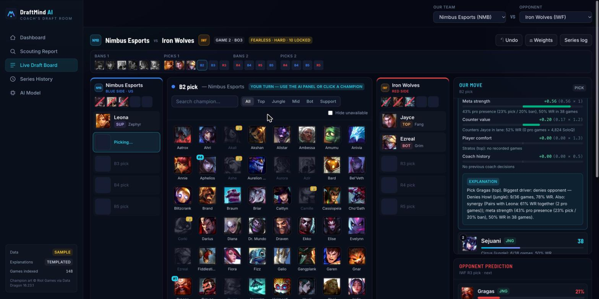
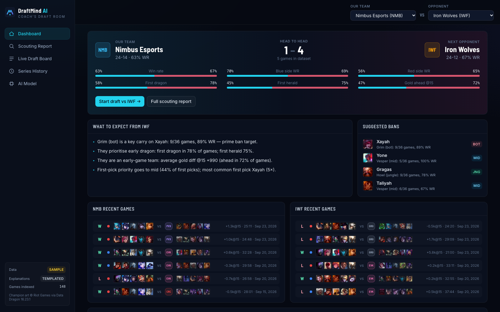
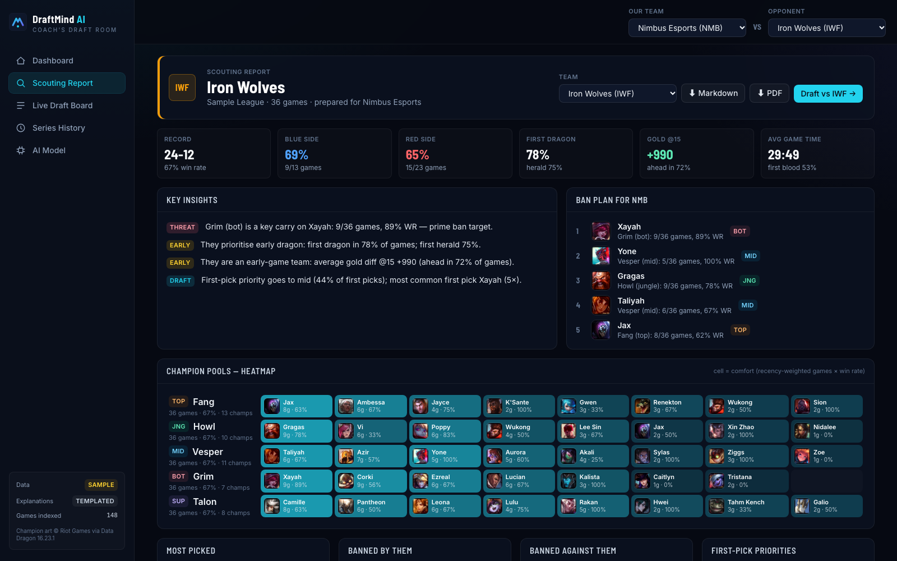
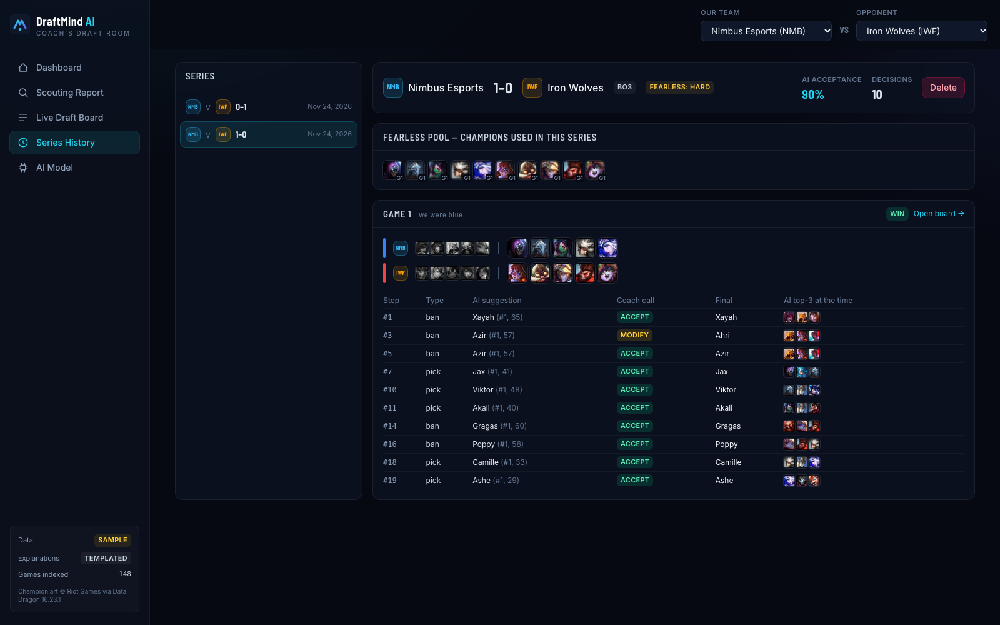
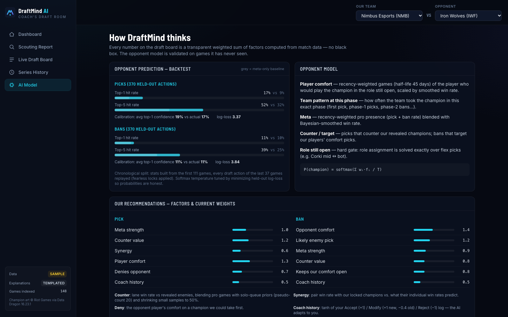
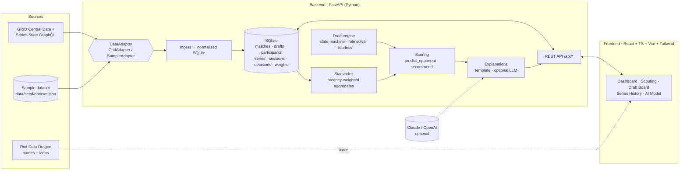

# DraftMind AI

**An explainable AI draft room for League of Legends coaches.** DraftMind scouts the opponent, predicts their next pick or ban with calibrated probabilities, and recommends your next move. Every score breaks down into the stats behind it. The coach stays in control: each suggestion can be accepted, modified or rejected, and DraftMind learns from those calls.

Built for the **Cloud9 × JetBrains "Sky's The Limit" Hackathon, Category 2: LoL Macro Scouting & Draft Management.**



| Dashboard | Scouting Report |
|---|---|
|  |  |
| **Series History** | **AI Model** |
|  |  |

---

## Why

Coaches still scout in spreadsheets: they count champion pools by hand, guess what the opponent will first-pick, and keep fearless-draft lockouts in their heads during a Bo5. DraftMind replaces that workflow with one tool:

| Capability | Where |
|---|---|
| **Opponent analysis**: per-player champion pools (heatmap), pick/ban tables, first-pick priorities, blue/red win rates, first blood/dragon/herald/tower, gold@15, auto-generated insights and a ban plan | Scouting Report, Dashboard |
| **Draft prediction**: the opponent's likely next pick or ban, top 5 with probabilities | Live Draft Board |
| **Recommendations**: our best next pick or ban, scored on meta strength, counter value, synergy, player comfort, denial and coach history | Live Draft Board |
| **Human in the loop**: Accept / Modify / Reject on every suggestion; each call is logged and shifts later suggestions | Live Draft Board, Series History |
| **Explainable AI**: a "Why?" breakdown on every suggestion (factor × weight = contribution, with the evidence), plus an optional plain-English explanation | Live Draft Board |
| **Fearless draft**: hard or soft fearless series tracking; used champions are locked out automatically in later games | Draft setup, Live Draft Board |
| **Tunable model**: coaches set the factor weights in a settings drawer | Live Draft Board → ⚖ Weights |
| **Export**: scouting report as Markdown, or as PDF through a print layout | Scouting Report |

## Quick start

The app runs fully offline on the bundled sample dataset. It needs no API keys.

### Option A: Docker (one command)

```bash
docker compose up --build
# → http://localhost:8080   (API + Swagger docs at http://localhost:8000/docs)
```

### Option B: no Docker (one command)

Requires Python ≥ 3.9 and Node ≥ 20.

```bash
./scripts/dev.sh          # or: make dev
# → http://127.0.0.1:5173  (API at http://127.0.0.1:8000/docs)
```

On the first run the script creates `backend/.venv` and runs `npm ci`. It then starts the FastAPI backend and the Vite dev server together.

<details><summary>Manual steps</summary>

```bash
# backend
cd backend && python3 -m venv .venv && .venv/bin/pip install -r requirements-dev.txt
.venv/bin/uvicorn app.main:app --reload --port 8000
# frontend (new terminal)
cd frontend && npm ci && npm run dev
```
</details>

### Optional configuration

Copy `.env.example` to `.env`:

| Variable | Effect |
|---|---|
| `GRID_API_KEY` | Switches the data source to live GRID esports data. If GRID fails, the app falls back to the sample data and says so on `/api/health`. |
| `ANTHROPIC_API_KEY` (or `OPENAI_API_KEY`) | The "Explain in plain English" button then uses an LLM (Claude `claude-opus-5-5` by default) to rephrase the factor breakdown. Without a key it uses templated explanations. |
| `DATA_SOURCE` | `auto` (default), `sample` or `grid` |
| `CORS_ORIGINS`, `DB_PATH`, `RECENCY_HALF_LIFE_DAYS`, `VITE_API_URL` | See `.env.example` |

## 3-minute demo script

1. **Dashboard**: pick *Nimbus Esports* vs *Iron Wolves*. The page shows head-to-head, side and early-game comparisons, what to expect from the opponent, and suggested bans.
2. **Scouting Report → Iron Wolves**: the champion-pool heatmap shows Grim (bot) on Xayah at 89% WR. The opponent takes first dragon in 78% of games and averages +990 gold@15. Click **Markdown** or **PDF** to export.
3. **Live Draft Board → Start draft** (Bo3, hard fearless, blue side):
   - B1 ban: the top suggestion is *Ban Xayah* (score 65). Click **Why?** to see each factor's contribution, then **Explain in plain English**.
   - Enter the opponent's bans by clicking the champion in the grid, or **Lock in** a predicted one.
   - On one suggestion click **Reject**: it disappears and is logged. On another click **Modify**, then pick your own champion in the grid.
   - Open **⚖ Weights**, raise *Player comfort*, and save. The suggestions re-score immediately.
4. Finish the draft, then click **We won** and **Start game 2**. Every champion from game 1 now shows 🔒, and the AI never suggests it.
5. **Series History**: the full draft of each game, every coach decision next to the AI's top 3 at that moment, and the AI acceptance rate.
6. **AI Model**: held-out backtest results against a baseline, and calibration.

## Architecture



```
/backend   FastAPI app (app/), engine (app/engine/), adapters (app/adapters/), tests/
/frontend  React + TypeScript + Vite + Tailwind v4 SPA
/data      champions.json (Data Dragon snapshot + role map), seed/dataset.json, scripts/ (generators)
/docs      screenshots
/.run      shared JetBrains run configurations
```

## Methodology

All analytics are computed from the normalized match tables. The engine does not know whether the data came from GRID or from the sample set.

### Statistics
- **Recency weighting**: each game counts `0.5^(age / 45 days)`, measured from the newest game in the dataset. Comfort and meta therefore track current form.
- **Bayesian smoothing**: win rates shrink toward 50% (`(wins + 0.5k)/(games + k)`), so a 1/1 record is never scored as a 100% win rate (the tables still show raw records).
- **Role solver**: Riot data has no positions. DraftMind combines a curated pro role map with an exact assignment solver over flex picks: Corki moves mid ↔ bot, and Gragas can go top, jungle or support. "Is the role still open?" is a hard feasibility check.
- **Matchups and synergy** blend pro lane results with solo-queue-style priors (pseudo-count 20). Synergy is measured as the pair's lift over the two champions' individual win rates.

### Opponent prediction
For every champion the opponent could legally take at this step:

`score = 1.6·comfort(player in the open role) + 2.0·team phase pattern + 2.4·meta + 0.5·counter-to-our-picks`

For bans the terms are *targets our players' comfort*, *team ban pattern in this phase*, *meta*, and *protects their picks*. Probabilities are `softmax(score / T)`.

### Our recommendation
`total = Σ wᵢ · fᵢ` over the factors below. The defaults are shown; coaches can tune them in the app.

| Pick factor | w | Ban factor | w |
|---|---|---|---|
| Meta strength | 1.0 | Opponent comfort (threat) | 1.4 |
| Counter value vs revealed enemies (lane ×1.0, others ×0.3) | 1.2 | Likely enemy pick (prediction model) | 1.2 |
| Synergy with our picks | 0.6 | Meta strength | 0.9 |
| Our player's comfort | 1.3 | Counters our locked picks | 0.8 |
| Denies the opponent's comfort | 0.7 | Keeps our own comfort open (penalty) | 0.8 |
| Coach history | 0.5 | Coach history | 0.5 |

The total shown in the UI is exactly the sum of the factor contributions, and a unit test asserts this.

### Human in the loop
Each decision is logged with the AI's top 5 at that moment. Accept counts +1, Reject −1, Modify +1 for the coach's champion and −0.4 for the suggestion. The coach-history factor is `tanh(Σ/2)` per champion and action type. A rejected champion is also hidden for the rest of that draft step.

### Validation
`/api/model/backtest` builds the stats from the earliest 75% of games, then replays all 740 draft actions in the newest 25%, with fearless locks applied:

| | Top-1 | Top-5 | Meta-only baseline (top-1 / top-5) | Avg top-1 confidence |
|---|---|---|---|---|
| Opponent picks | **17%** | **52%** | 9% / 32% | 19% |
| Opponent bans | **11%** | **39%** | 10% / 25% | 11% |

The factor weights were grid-searched on this split. The softmax temperatures (picks 0.9, bans 0.7) were set by minimizing held-out log-loss, so a "20%" on the board means roughly 20%. The tuning shows a flat optimum (±1 point), so the model is not over-fit to a single weight setting.

### Explanations
The templated text is generated from the top factors and their evidence strings, for example *"Denies Howl (jungle): 9/36 games, 78% WR"*. When an LLM key is set, the model receives only those facts and is told not to add any. Any API failure, refusal or timeout falls back to the template.

## Data

- **Sample dataset** (`data/seed/dataset.json`): 8 fictional teams, 56 fearless Bo3 series and **148 games**. Every game has a full 20-action draft, role assignments, first blood/dragon/herald/tower, gold@15 and duration. A deterministic simulator (`data/scripts/generate_seed.py`) produces it from hidden ground truth: player champion pools, team first-pick tendencies, ban styles, patch meta drift, lane matchups and synergies. That gives the analytics real patterns to find. **All teams, players and numbers are synthetic.**
- **GridAdapter** (`backend/app/adapters/grid.py`): reads `GRID_API_KEY` and pages recent LoL esports series from the Central Data API. It then pulls each series' games, players, champions and draft actions from the Series State API. Roles are inferred with the same role solver. Objective timings and gold@15 are not part of Series State, so the UI shows *n/a* for those.
- **Riot Data Dragon**: `data/champions.json` is a snapshot of champion ids, names and tags (`make champions` refreshes it). Icons load from the public Data Dragon CDN, with an initials fallback when offline. No other Riot assets are used.

## API

Interactive docs are at `/docs` (Swagger). The main endpoints:

| Method & path | Purpose |
|---|---|
| `GET /api/health` | Data source, dataset size, LLM provider |
| `GET /api/teams`, `/api/teams/{id}`, `/api/matches?team=&opponent=` | Reference data |
| `GET /api/dashboard?our=&opp=` | Matchup summary |
| `GET /api/teams/{id}/scouting?vs=` · `/scouting.md` | Scouting report as JSON or Markdown |
| `POST /api/series` · `POST /api/series/{id}/games` · `GET /api/series/{id}` | Series, games and fearless pool |
| `GET /api/drafts/{id}` | Draft state, prediction and recommendations |
| `POST /api/drafts/{id}/actions` · `/undo` · `/decisions` · `/result` · `/explain` | Draft workflow |
| `GET/PUT /api/settings/weights` · `POST /api/settings/weights/reset` | Recommendation weights |
| `GET /api/model/backtest` | Held-out accuracy and calibration |

## Tests

```bash
make test        # pytest (30 tests) + TypeScript type-check and production build
```

- `tests/test_draft.py` covers the draft-order state machine (exact pro order, apply/undo/completion, duplicate and unknown champions), the flex role solver, and hard/soft/off fearless locks.
- `tests/test_scoring.py` covers softmax, smoothing, comfort, prediction ordering and availability, the counter factor, weights changing the ranking, ban targeting, rejection exclusion, coach-affinity math, and that each total equals the sum of its factor contributions.
- `tests/test_api.py` runs a full Bo3 series through the API (reject, modify, accept, undo, result, fearless lock in game 2, explain), plus scouting/Markdown, weights round-trip, the backtest beating its baseline, and validation errors.

## Deployment

**Render (one service: API + UI).** Create a *Blueprint* from `render.yaml`. It builds `backend/Dockerfile`, which bundles the built frontend so the UI and the API share one origin, and health-checks `/api/health`.

- **Password.** The whole site is behind HTTP Basic auth. The user is `DEMO_USER` (`judge`). Render generates `DEMO_PASSWORD`; read it in the dashboard under Environment. Only `/api/health` is open. Leave `DEMO_PASSWORD` empty to run the site without a login.
- **GRID data.** Set `GRID_DATA=1` to build with the official hackathon data. At build time, the image clones it from Cloud9's repository, builds the normalized cache, and deletes the raw match feeds. The data is never in this repository. Its license allows showing results to judges and organizers only, which is why the site is password-protected. Remove the deployment when judging ends.
- **Saved data.** The free plan's disk is ephemeral, so coach decisions reset on redeploy. To keep them, attach a disk and set `DB_PATH`.

**Run with the GRID data locally.** Clone the data next to this repository:

```bash
git clone --filter=blob:none --sparse https://github.com/cloud9esports/stl-hackathon-2026-grid-starter.git ../stl-hackathon-2026-grid-starter
git -C ../stl-hackathon-2026-grid-starter sparse-checkout set lol meta
```

With `DATA_SOURCE=auto` (the default), the backend uses the data when it finds it at `STL_DATA_DIR`. The default location is `../stl-hackathon-2026-grid-starter`. The first start parses the feeds in about 45 s and caches the result in `backend/var/`. Later starts read the cache.

**Retrain the opponent model** on the GRID data: `cd backend && python -m scripts.fit_opponent_model`. This writes `app/engine/model_weights.json`.

## How JetBrains tools were used

| Tool | What it did in this project | Evidence in the repo |
|---|---|---|
| **PyCharm** | The repository is set up as a PyCharm project: the Python 3.12 interpreter from `backend/.venv` is configured, pytest is the test runner, and three shared run configurations start the API, the test suite and the Vite dev server. | [`.idea/`](.idea), [`.run/`](.run) |
| **Qodana** (`qodana-python-community:2025.3`) | Static analysis of the backend. The first scan reported 22 problems, 4 of them high severity. We fixed all 4: replaced the deprecated `datetime.utcnow()` with timezone-aware `datetime.now(timezone.utc)` in two places, and replaced `set([...])` calls with set literals. In the same pass we narrowed a bare `except Exception` in the backtest to `DraftError` and removed unused locals in the tests. After the fixes, the scan reports no high-severity problems. All 30 backend tests that existed at the time still passed. | [`qodana.yaml`](qodana.yaml), commit *"Fix Qodana findings in the backend"* |
| **Junie** (run from PyCharm) | Wrote `test_dashboard_ban_plan` from our prompt: *"Add a pytest test … that checks /api/dashboard?our=NMB&opp=IWF returns a ban_plan with at most 5 entries, and that each entry has a non-empty champion field … Then run the backend tests."* Junie followed the existing `client` fixture style and ran the suite. We reviewed the diff and accepted it. The suite went from 30 to 31 passing tests. | [`backend/tests/test_api.py`](backend/tests/test_api.py), commit *"Add dashboard ban-plan test (written by Junie)"* |
| **HTTP Client** | API smoke tests: 11 requests with JavaScript assertions covering health, teams, the dashboard, scouting, 404 handling and a full flow (create a Bo3 fearless series → start a game → read the ranked recommendations → apply the top pick → undo → delete the series). Two environments, `local` and `prod`. Against the deployed API on Render: **11/11 passed**. | [`http/api.http`](http/api.http), [`http/http-client.env.json`](http/http-client.env.json) |

### Reproduce
- **PyCharm:** open the repository root, then run *Backend tests*, *Backend API* or *Frontend (vite dev)* from the run-configuration menu. To run the API checks, open `http/api.http`, select the `local` or `prod` environment and choose *Run all*.
- **HTTP Client CLI:**
  ```bash
  docker run --rm -v "$PWD/http":/workdir jetbrains/intellij-http-client \
    --no-progress -v http-client.env.json -e prod -t 60000 api.http
  ```
- **Qodana:**
  ```bash
  docker run --rm -v "$PWD":/data/project/ -v "$PWD/.qodana-results":/data/results/ \
    jetbrains/qodana-python-community:2025.3
  ```

## Limitations and next steps
- The bundled data is **synthetic**. Real-world accuracy depends on GRID data volume. The GRID adapter follows GRID's documented GraphQL schema, but it was not run against a live key during development.
- SQLite with a single process is fine for a coaching staff, but would need Postgres for multi-tenant use.
- Next steps: patch-aware meta from Data Dragon item/patch notes, side-selection advice for fearless series, and draft-phase win-probability curves.

## License

[MIT](LICENSE). Champion names and icons are © Riot Games, used through the public Data Dragon CDN under Riot's Legal Jibber Jabber policy. DraftMind AI is not endorsed by Riot Games, Cloud9, GRID or JetBrains.
